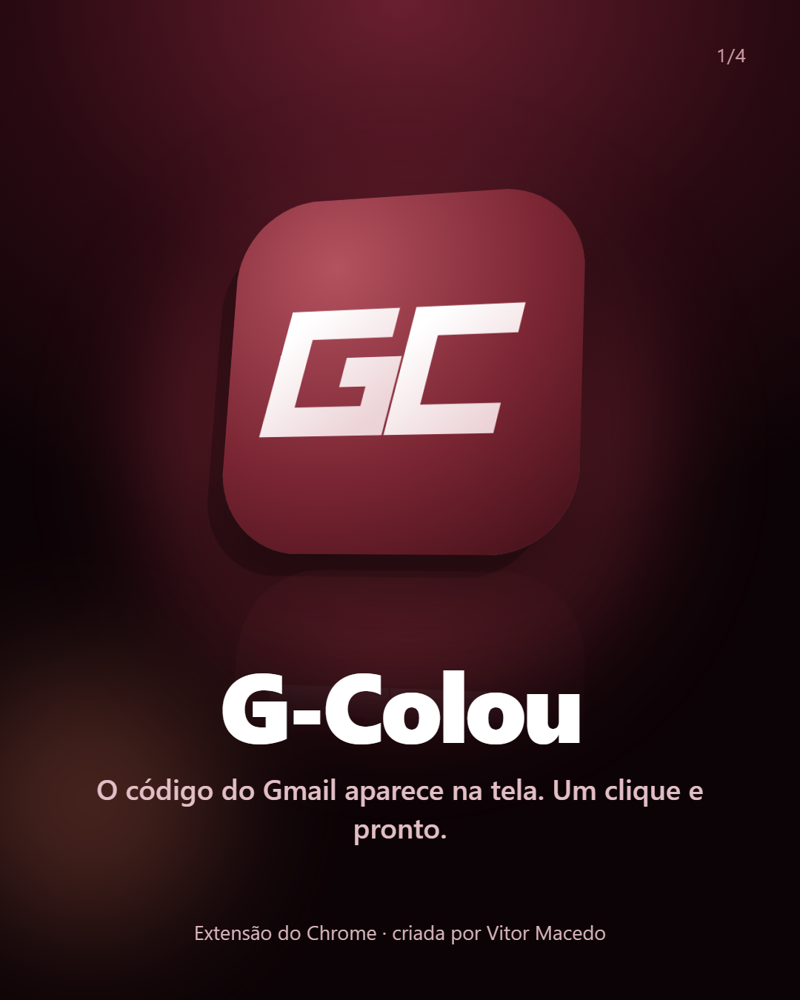
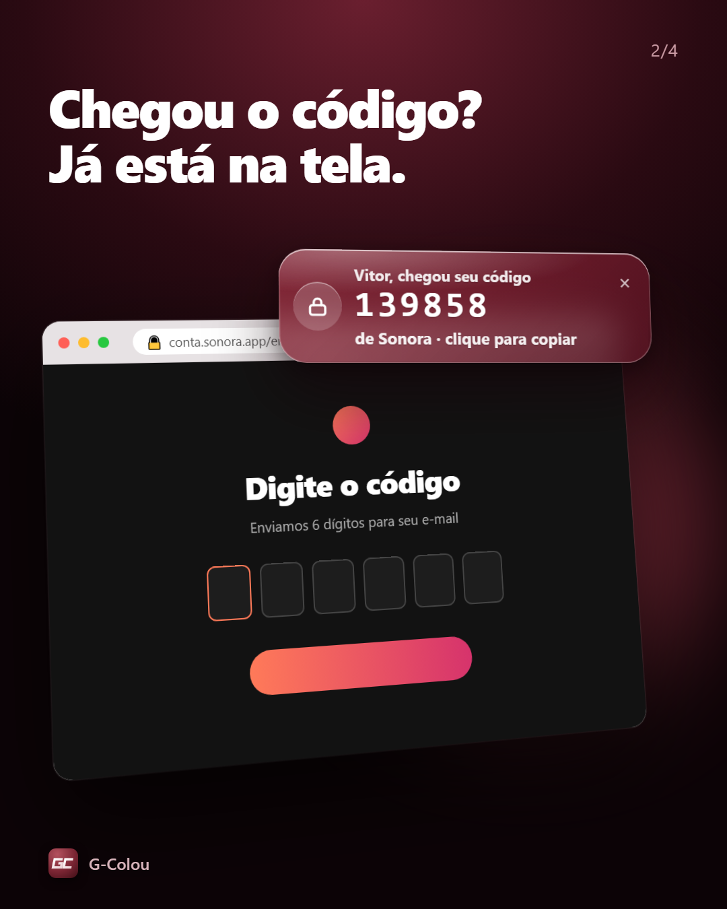
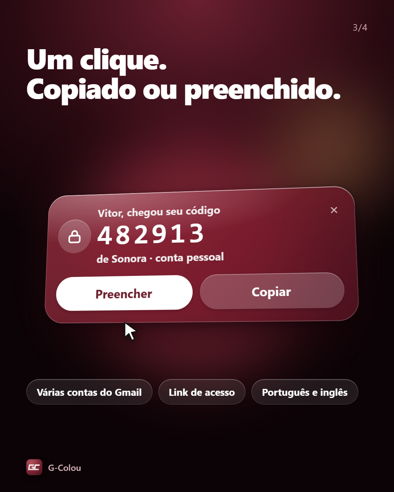
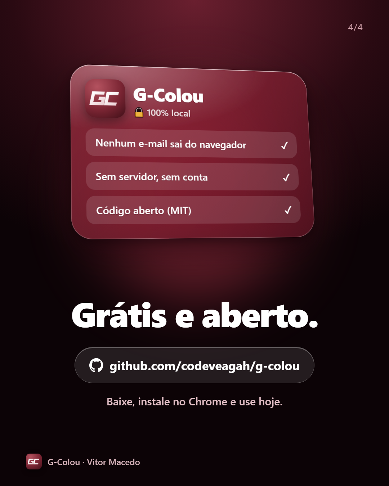

<p align="center"></p>

<h1 align="center">G-Colou</h1>

<p align="center">Chegou código de verificação no Gmail? Ele aparece num card no canto da página. Um clique e está copiado.<br>Sem abrir o Gmail. <b>100% local.</b></p>

<p align="center">
  
  
</p>
<p align="center">
  
  
</p>

---

## O que faz

Você pede um código de verificação em qualquer site (Spotify, Discord, Microsoft...). Em 2 ou 3 segundos aparece um card:

> **Vitor, chegou seu código**
> **482913**
> de Spotify · clique para copiar

- **Card de vidro** (estilo Liquid Glass do iPhone): aparece compacto e abre ao passar o mouse.
- **Clique** no card ou em **Copiar**: o código vai para a área de transferência.
- **Preencher:** coloca o código direto no campo da página (só aparece quando o e-mail é do próprio site).
- **Link de acesso** ("entrar sem senha"): o card mostra **Abrir e-mail** e abre aquele e-mail no Gmail.
- **Várias contas:** lê todas as contas do Gmail logadas no Chrome (até 5) e mostra de qual conta veio.
- **Arraste** o card pelo ✥ para onde quiser; ele lembra o lugar.
- **Borda laranja:** o código veio de uma empresa diferente do site aberto. Confira antes de usar (pode ser site falso). Precisa de dois cliques para copiar.
- Código **copiado ou fechado** não aparece de novo.

## Privacidade: 100% local

A extensão lê o feed do Gmail (`mail.google.com/mail/feed/atom`) com o login que você já tem no Chrome. **Nenhum e-mail, código ou dado sai do seu navegador.** Não tem servidor, conta, OAuth nem rastreamento. O código-fonte inteiro está aqui para conferir.

- Guarda só os ids dos e-mails já vistos (para não repetir) e as suas opções.
- O código fica na memória por 2 minutos e nunca é gravado em disco.

## Requisitos

- **Navegador:** Google Chrome 116 ou mais novo. Também roda em navegadores baseados no Chromium (Edge, Brave, Opera), instalando do mesmo jeito.
- **Sistema:** qualquer um em que o Chrome atual roda: Windows 10 ou 11, macOS 12 (Monterey) ou mais novo, Linux.
- **Não roda** no Windows 7/8 nem em macOS antigo: o Chrome parou de atualizar neles e ficou abaixo da versão 116.
- **Gmail** logado no mesmo Chrome.

## Como instalar

1. Baixe o **[g-colou.zip da última versão](https://github.com/codeveagah/g-colou/releases/latest/download/g-colou.zip)** e descompacte numa pasta que você não vai apagar.
   (Ou, para mexer no código: `git clone https://github.com/codeveagah/g-colou.git`.)
2. No Chrome, abra `chrome://extensions`.
3. Ligue o **Modo do desenvolvedor** (canto superior direito).
4. Clique em **Carregar sem compactação** (no macOS, "Load unpacked") e escolha a pasta que tem o `manifest.json`.
5. Fixe o G-Colou no ícone de quebra-cabeça da barra.
6. Esteja logado no Gmail neste Chrome. Pronto.

Para testar: peça um código de verificação em qualquer site e espere o card aparecer, sem abrir o Gmail.

> Não mova nem apague a pasta depois de instalar: o Chrome lê os arquivos direto dela. Deixe o Modo do desenvolvedor ligado.

## Opções

Clique no ícone do G-Colou:

- **Ligado / desligado**, com prévia do card
- **Seu nome** (aparece no card)
- **Copiar automaticamente** (desligado por padrão; só copia sozinho se o remetente bate com o site)
- **Posicionar na tela:** mostra um card de exemplo na página para você arrastar até o lugar padrão
- **Todas as contas do Gmail** (ligado por padrão)
- **Lado da tela** (esquerda ou direita)

Idioma: português ou inglês, conforme o idioma do Chrome.

## Limites

- Lê só a caixa de entrada e só e-mails **não lidos** dos últimos 5 minutos. Se você abrir o e-mail antes, o card não aparece.
- Usa a prévia do e-mail (~200 caracteres). Código no fim de e-mail longo pode não ser achado.
- Link de acesso: o feed não traz o link de dentro do e-mail, então o card abre o e-mail (não o link direto).
- Conta de empresa (Google Workspace) pode ter o feed bloqueado pelo administrador.
- O feed Atom do Gmail não é oficial: o Google pode mudar ou desligar.
- Só roda em sites `https://`.

## Modificar

Projeto em JavaScript puro, sem build e sem dependências.

```
src/lib.js          lê o feed, acha o código, compara remetente com o site
src/background.js   service worker: lê o Gmail e entrega o código à aba
src/content.js      card na página (arrastar, copiar, posição)
src/options.*       menu de opções
_locales/           textos em português e inglês
dev/                prévias locais do card e do menu (sem extensão)
test/lib.test.js    testes (node --test)
```

Para ver o visual sem instalar: rode um servidor estático na pasta (ex.: `npx serve .`) e abra `dev/preview.html` ou `dev/options-preview.html`.

Mudou algo? Rode os testes e clique no ↻ do G-Colou em `chrome://extensions`:

```
npm test
```

Faltou um formato de código ou um remetente? Acrescente um caso em `test/lib.test.js` e ajuste `extractCode` ou a tabela `FAMILY` em `src/lib.js`.

## Licença

[MIT](LICENSE): use, modifique e distribua à vontade, mantendo o aviso de copyright.

Criado por **[Vitor Macedo](https://vitormacedobr.vercel.app)**.
